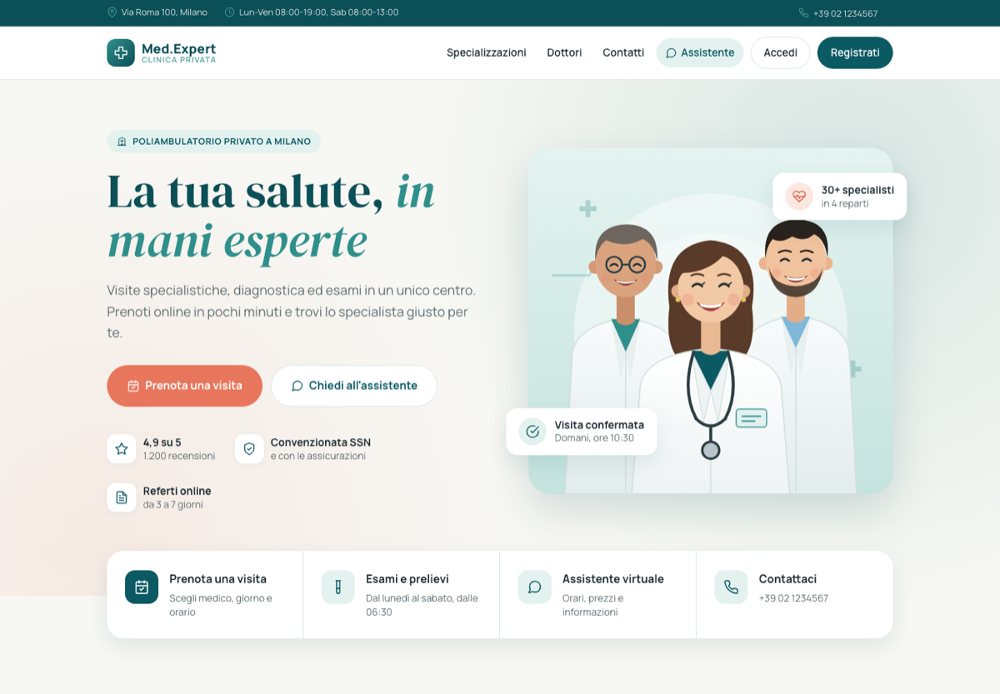
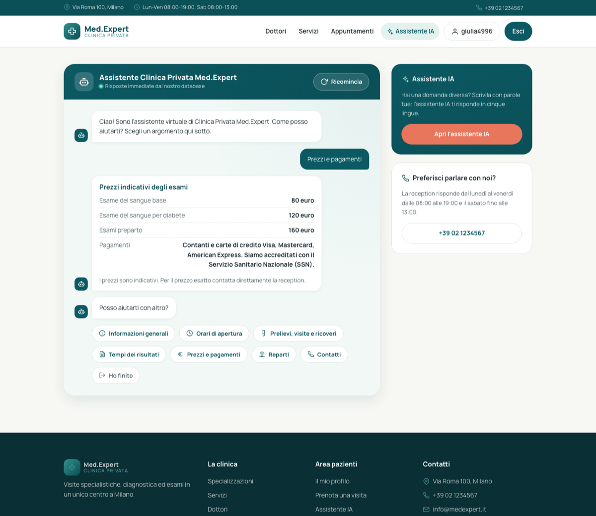
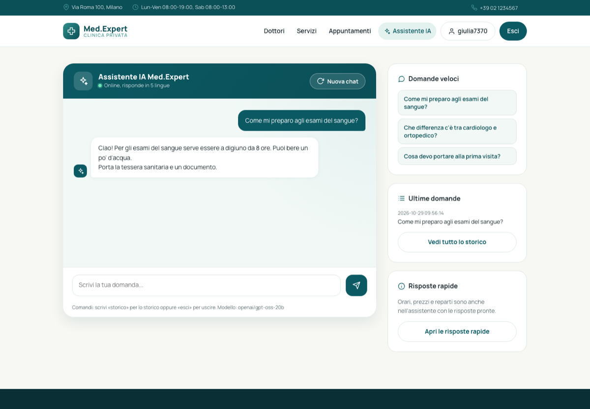

# Clinica Privata Med.Expert

Sito di una clinica privata fatto con **Flask**, **Jinja2** e **SQLite**: pagina di presentazione, area pazienti con login, gestionale per l'amministratore e due assistenti virtuali, uno con risposte dal database e uno con intelligenza artificiale (Groq).

Progetto finale del corso di sviluppo web, 2026.



## Cosa fa

- **Landing page** con reparti, servizi, équipe, recensioni, domande frequenti e contatti.
- **Registrazione e login** con username e password. La password è salvata cifrata (SHA-256). Dopo la registrazione l'utente entra subito e vede la pagina di conferma.
- **Due ruoli**:
  - `user`: vede dottori e servizi, prenota appuntamenti, usa l'assistente IA, modifica il proprio profilo;
  - `admin`: gestisce pazienti, dottori, servizi e utenti.
- **Assistente statico** per chi non ha fatto il login: orari, prezzi degli esami, reparti e contatti presi dal database.
- **Assistente IA** dopo il login: chat con il modello `openai/gpt-oss-20b` su Groq, che risponde in cinque lingue e ricorda il contesto. Le domande e le risposte vengono salvate nello storico.
- **JOIN tra tabelle**: l'elenco dei pazienti mostra il medico di ciascuno (`pazienti JOIN dottori`).

| Assistente statico | Assistente IA |
| --- | --- |
|  |  |

## Struttura

```
app.py                  crea l'app Flask (durka) e registra il blueprint
config.py               legge SECRET_KEY e chiave Groq dal file .env
seed.py                 crea l'utente amministratore
controllers/
    controller.py       tutte le route (blueprint durka_route)
models/
    database.py         tabelle SQLite e funzioni per leggere e scrivere i dati
templates/              pagine Jinja2 (base.html e le altre la estendono)
static/
    style.css           stile di tutto il sito
    img/medici.svg      illustrazione della pagina iniziale
```

## Come avviarlo

Serve Python 3.10 o più recente.

```bash
git clone https://github.com/forchivi/clinica-med-expert.git
cd clinica-med-expert
python3 -m venv .venv
source .venv/bin/activate
pip install -r requirements.txt
cp .env.example .env
```

Nel file `.env` inserisci la tua chiave di [Groq](https://console.groq.com/keys). Senza chiave il sito funziona lo stesso, solo l'assistente IA mostra un avviso.

```bash
python app.py        # crea il database e avvia il sito
```

In un secondo terminale, una sola volta, crea l'amministratore `admin` / `admin123`:

```bash
python seed.py
```

Apri <http://127.0.0.1:5000>. Su macOS usa `127.0.0.1` e non `localhost`: la porta 5000 su `localhost` è occupata da AirPlay.

## Note

- I dati della clinica, i nomi dei medici e le recensioni sono di esempio.
- Le foto dei medici vengono da [Unsplash](https://unsplash.com). Le icone e l'illustrazione sono disegnate in SVG per questo progetto.
- La password dell'amministratore `admin123` serve solo per la prova in locale: cambiala dal profilo.
